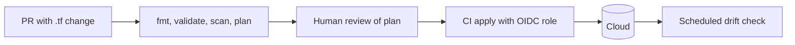

# Infrastructure as Code

## Problem

Hand-built infrastructure cannot be reproduced, reviewed, or audited. Environments drift apart, disaster recovery depends on someone's memory, and security settings change without a trace.

## Solution

Declare resources in code (Terraform/OpenTofu, Pulumi, CloudFormation), store it in git, review changes via pull requests with a `plan` output attached, and apply only from CI with a dedicated identity. Keep state remote, locked, and encrypted. Detect drift on a schedule. Scan code for misconfiguration (Checkov, tfsec/Trivy) before apply.



## Example

```hcl
terraform {
  required_version = ">= 1.6"
  backend "s3" {
    bucket         = "acme-tfstate"
    key            = "prod/app.tfstate"
    region         = "ap-south-1"
    dynamodb_table = "tf-locks"      # state locking
    encrypt        = true
  }
}

resource "aws_s3_bucket" "uploads" {
  bucket = "acme-prod-uploads"
  tags   = { owner = "platform", env = "prod" }
}

resource "aws_s3_bucket_public_access_block" "uploads" {
  bucket                  = aws_s3_bucket.uploads.id
  block_public_acls       = true
  block_public_policy     = true
  ignore_public_acls      = true
  restrict_public_buckets = true
}

resource "aws_s3_bucket_server_side_encryption_configuration" "uploads" {
  bucket = aws_s3_bucket.uploads.id
  rule { apply_server_side_encryption_by_default { sse_algorithm = "aws:kms" } }
}
# CI: terraform fmt -check && terraform validate && checkov -d . && terraform plan -out=plan
```

## Tradeoffs

- Reproducibility, review, and audit versus a learning curve and slower one-off changes.
- State files become critical and sensitive assets.

## Failure modes

- Manual console hotfixes cause drift that the next apply silently reverts.
- Lost or corrupted state; concurrent applies without locking.
- Huge monolithic stacks where every plan touches everything and nobody reviews it.

## Security implications

- State files can contain secrets in plain text; encrypt, restrict, and never commit them.
- The CI apply identity is highly privileged; use OIDC federation instead of long-lived keys and scope it per environment.
- Policy-as-code scanning catches public buckets and open security groups before they exist.

## When to use

- Any cloud infrastructure that outlives a single experiment.

## When not to use

- Throwaway sandboxes torn down within hours (still consider it once you do the same setup twice).

Back to [[Patterns-Index]].
