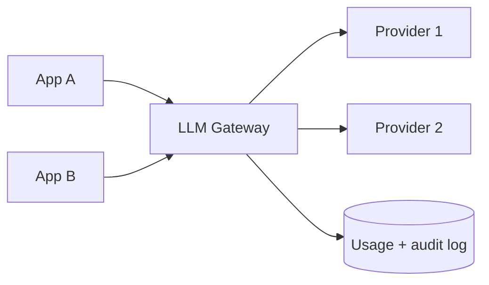

# LLM Gateway

## Problem

Each team calls LLM providers directly with its own API key. Costs are untracked, keys are scattered, prompts containing PII go to vendors unlogged, and switching providers or adding fallbacks means changing every application.

## Solution

Put a gateway service between applications and providers. Applications authenticate to the gateway with their own identity; only the gateway holds provider keys. The gateway enforces per-app budgets and rate limits, redacts sensitive data, logs metadata (model, tokens, latency, cost, app) and optionally prompts under a retention policy, normalizes the API across providers, and applies routing, caching, and fallback.



## Example

```python
import time, re
from fastapi import FastAPI, Depends, HTTPException
from pydantic import BaseModel

app = FastAPI()
EMAIL = re.compile(r"[\w.+-]+@[\w-]+\.[\w.]+")
BUDGET_TOKENS = {"support-bot": 2_000_000, "docs-search": 500_000}   # per day, per app
used: dict[str, int] = {}

class ChatReq(BaseModel):
    model: str
    messages: list[dict]
    max_tokens: int = 512

def caller_app(token: str = Depends(verify_service_token)) -> str:   # mTLS/JWT per app
    return token

@app.post("/v1/chat")
def chat(req: ChatReq, app_id: str = Depends(caller_app)):
    if used.get(app_id, 0) + req.max_tokens > BUDGET_TOKENS.get(app_id, 0):
        raise HTTPException(429, "token budget exhausted")
    msgs = [{**m, "content": EMAIL.sub("[EMAIL]", m["content"])} for m in req.messages]
    start = time.monotonic()
    resp = route(req.model, msgs, req.max_tokens)        # provider adapter + fallback chain
    used[app_id] = used.get(app_id, 0) + resp.total_tokens
    log_usage(app=app_id, model=resp.model, tokens=resp.total_tokens,
              latency_ms=int((time.monotonic() - start) * 1000))   # metadata, not content
    return {"content": resp.text, "model": resp.model}
```

## Tradeoffs

- Central control and visibility versus an extra hop and a critical shared dependency.
- A lowest-common-denominator API can hide provider-specific features (tool use formats, caching) unless passed through deliberately.

## Failure modes

- Gateway outage takes down every AI feature; run it redundantly and consider direct-call fallbacks for critical paths.
- Streaming responses buffered by the gateway destroy latency.
- Regex redaction misses PII and gives false assurance.

## Security implications

- Single place to hold provider keys, enforce data-handling rules, and audit usage.
- Prompt logs are sensitive data; restrict access and set retention.
- The gateway does not solve prompt injection; applications still need output validation and least-privilege tools.

## When to use

- More than one application or team using LLMs, or any regulated data flowing to models.

## When not to use

- A single prototype calling one model; a well-structured client library is enough initially.

Back to [[Patterns-Index]].
