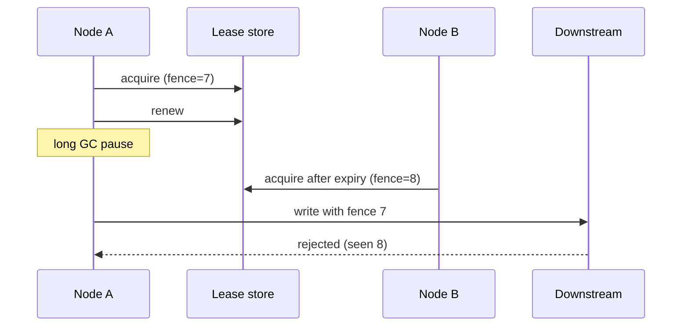

# Leader Election

## Problem

Several replicas run for availability, but some work must be done by only one at a time: scheduled jobs, partition ownership, compaction, sending a daily email. Running it on every replica duplicates work; hardcoding one replica removes availability.

## Solution

Instances compete for a lease in a strongly consistent store (etcd, ZooKeeper, Consul, Kubernetes Lease objects, or a database row). The holder renews it before the TTL expires; if it stops renewing, another instance takes over. Because a paused old leader may still believe it leads, each acquisition returns a monotonically increasing fencing token, and downstream writes reject tokens older than the latest seen.



## Example

```sql
-- Lease table (PostgreSQL). One row per singleton task.
CREATE TABLE leases (
  name        text PRIMARY KEY,
  holder      text NOT NULL,
  expires_at  timestamptz NOT NULL,
  fence       bigint NOT NULL DEFAULT 0
);

-- Acquire or renew: succeeds if free, expired, or already ours. Returns the fencing token.
INSERT INTO leases (name, holder, expires_at, fence)
VALUES ('nightly-billing', :me, now() + interval '15 seconds', 1)
ON CONFLICT (name) DO UPDATE
   SET holder = EXCLUDED.holder,
       expires_at = EXCLUDED.expires_at,
       fence = CASE WHEN leases.holder = EXCLUDED.holder THEN leases.fence
                    ELSE leases.fence + 1 END
 WHERE leases.holder = EXCLUDED.holder OR leases.expires_at < now()
RETURNING fence;          -- no row returned => someone else leads

-- Fenced write: reject stale leaders.
UPDATE billing_runs SET status = 'done', fence = :fence
 WHERE run_date = :d AND fence <= :fence;
-- Renew every ~5s; stop work immediately if renewal fails.
```

## Tradeoffs

- Availability for singleton work versus coordination complexity and a dependency on a consistent store.
- Short TTLs mean faster failover but more renewals and more false failovers during GC pauses or network blips.

## Failure modes

- Split brain: an old leader paused past its lease keeps writing without fencing.
- Clock skew between nodes when lease expiry is judged by local clocks (judge by the store's clock).
- Leader does work without checking it still holds the lease.

## Security implications

- The coordination store is critical: restrict who can write leases, since a malicious or buggy client can seize leadership.
- Authenticate nodes to the store (mTLS) and audit leadership changes.

## When to use

- Schedulers, partition owners, controllers, single-writer workflows in replicated services.

## When not to use

- Work that can be made idempotent and run by any instance, or naturally partitioned via a queue with consumer groups.

Back to [[Patterns-Index]].
