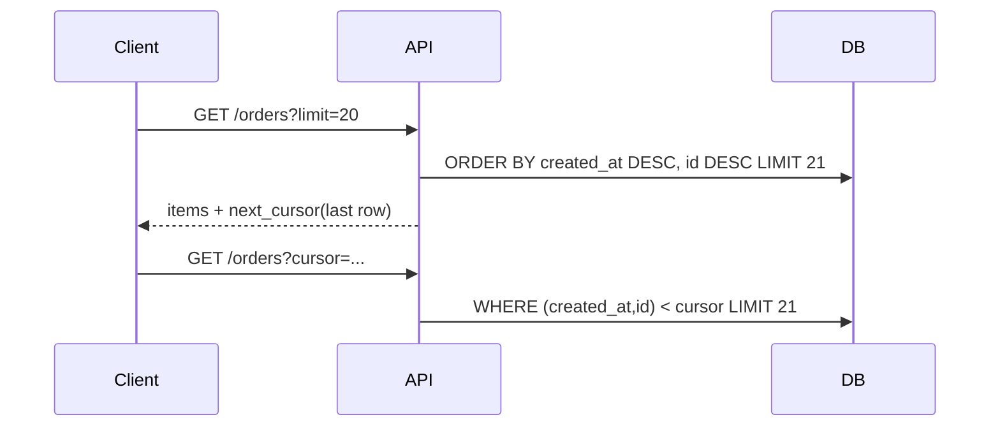

# Cursor Pagination

## Problem

`LIMIT 20 OFFSET 100000` forces the database to scan and discard 100000 rows, so late pages get slower as the table grows. When rows are inserted or deleted between requests, offset pages also skip or duplicate items, which breaks infinite scroll and sync jobs.

## Solution

Sort by a unique, immutable key (often `(created_at, id)`), return the key of the last row as an opaque, encoded cursor, and fetch the next page with a keyset predicate (`WHERE (created_at, id) < (:ts, :id)`). An index on the sort key makes every page an index range scan of roughly constant cost.



## Example

```python
import base64, json
from fastapi import FastAPI, Query, HTTPException

app = FastAPI()

def encode(ts: str, id_: int) -> str:
    return base64.urlsafe_b64encode(json.dumps([ts, id_]).encode()).decode()

def decode(cursor: str) -> tuple[str, int]:
    try:
        ts, id_ = json.loads(base64.urlsafe_b64decode(cursor.encode()))
        return str(ts), int(id_)
    except Exception:
        raise HTTPException(400, "invalid cursor")

@app.get("/orders")
def list_orders(limit: int = Query(20, le=100), cursor: str | None = None):
    sql = "SELECT id, created_at, total FROM orders"
    params: dict = {"limit": limit + 1}
    if cursor:
        ts, id_ = decode(cursor)
        sql += " WHERE (created_at, id) < (:ts, :id)"
        params |= {"ts": ts, "id": id_}
    sql += " ORDER BY created_at DESC, id DESC LIMIT :limit"
    rows = db.execute(sql, params).fetchall()   # db: your connection
    has_more = len(rows) > limit
    rows = rows[:limit]
    nxt = encode(str(rows[-1].created_at), rows[-1].id) if has_more else None
    return {"items": [dict(r._mapping) for r in rows], "next_cursor": nxt}
# Index: CREATE INDEX ON orders (created_at DESC, id DESC);
```

## Tradeoffs

- Constant-cost pages and stable results under concurrent writes.
- No random access: clients cannot jump to page 57.
- Total counts are a separate (often expensive) query.
- Changing the sort order requires a different cursor and index.

## Failure modes

- Non-unique sort key (only `created_at`) causes skipped or duplicated rows on ties; always add a tiebreaker.
- Missing composite index turns keyset queries back into scans.
- Cursor format leaks into clients that parse it, making later changes breaking.

## Security implications

- Treat the cursor as untrusted input: decode defensively, validate types, never interpolate into SQL.
- Base64 is not encryption; if the cursor embeds anything sensitive, sign or encrypt it (HMAC).
- Cap `limit` server-side to prevent resource exhaustion.

## When to use

- Feeds, timelines, audit logs, sync/export APIs over large or append-heavy tables.

## When not to use

- Small admin tables where page numbers are a UX requirement and OFFSET cost is negligible.

Back to [[Patterns-Index]].
