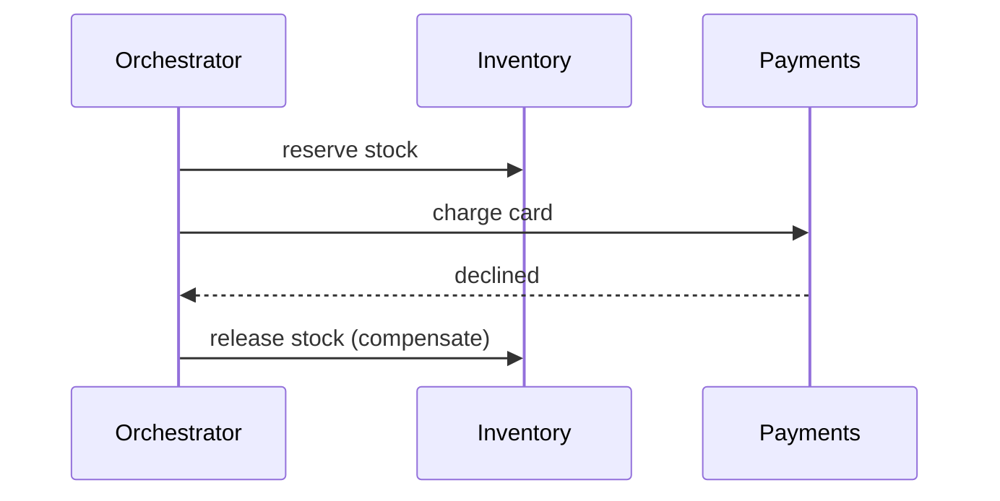

# Saga

## Problem

Placing an order touches inventory, payments, and shipping, each owning its own database. A distributed ACID transaction across them is unavailable or too coupled, yet partial failure (payment declined after stock was reserved) must not leave the system inconsistent.

## Solution

Split the workflow into steps, each a local transaction in one service, each paired with a compensating action that semantically undoes it (release stock, refund). An orchestrator (central state machine) or choreography (services react to each other's events) drives the steps. On failure, completed steps are compensated in reverse order. Every step and compensation must be idempotent and retryable.



## Example

```python
from dataclasses import dataclass, field
from typing import Callable

@dataclass
class Step:
    name: str
    action: Callable[..., None]
    compensate: Callable[..., None]

@dataclass
class SagaOrchestrator:
    steps: list[Step]
    log: list[str] = field(default_factory=list)   # persist this in real systems

    def run(self, ctx: dict) -> bool:
        done: list[Step] = []
        for step in self.steps:
            try:
                step.action(ctx)                     # must be idempotent
                done.append(step); self.log.append(f"done:{step.name}")
            except Exception as exc:
                self.log.append(f"failed:{step.name}:{exc}")
                for prev in reversed(done):
                    prev.compensate(ctx)             # must be idempotent and retried until success
                    self.log.append(f"compensated:{prev.name}")
                return False
        return True

def decline(ctx): raise RuntimeError("card declined")

saga = SagaOrchestrator([
    Step("reserve_stock", lambda c: c.update(reserved=True), lambda c: c.update(reserved=False)),
    Step("charge_card",   decline,                           lambda c: c.update(refunded=True)),
    Step("create_shipment", lambda c: c.update(shipped=True), lambda c: c.update(shipped=False)),
])
ctx = {"order_id": "o-42"}
assert saga.run(ctx) is False and ctx["reserved"] is False
```

## Tradeoffs

- Avoids distributed locks and 2PC, at the cost of eventual consistency and intermediate states visible to users.
- Orchestration is easier to reason about and monitor; choreography has less central coupling but is harder to trace.
- Compensation is semantic, not a true rollback (an email already sent cannot be unsent).

## Failure modes

- Orchestrator crashes mid-saga without persisted state: steps are orphaned. Persist saga state and resume.
- Compensation fails and is not retried, leaving money or stock stuck.
- Concurrent sagas on the same resources cause anomalies (lack of isolation); use semantic locks such as a `PENDING` status.

## Security implications

- Every step call must be authenticated service-to-service; the orchestrator often holds broad privileges, so scope its credentials tightly.
- Saga logs contain business data; protect and retain them like the underlying records.

## When to use

- Business transactions spanning several services or external systems (bookings, orders, onboarding).

## When not to use

- When all data lives in one database; use a local transaction instead.

Back to [[Patterns-Index]].
