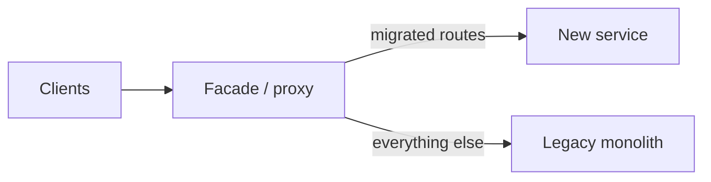

# Strangler Fig

## Problem

Big-bang rewrites of legacy systems run for months without delivering value, drift from the still-changing old system, and fail at cutover. Meanwhile the legacy system is too risky to keep extending.

## Solution

Put a routing facade (reverse proxy, API gateway, or in-app router) in front of the legacy system. Re-implement one capability at a time in the new system, switch its routes over (often gradually via flags or canaries), verify, and delete the legacy code for it. Repeat until the legacy system handles nothing and can be removed.



## Example

```nginx
# Facade: nginx routes migrated paths to the new service, everything else to legacy.
upstream legacy_app { server legacy:8080; }
upstream new_app    { server orders-svc:8000; }

# 10% of traffic for /api/orders goes to the new service during rollout
split_clients "${remote_addr}${http_user_agent}" $orders_backend {
    10%     new_app;
    *       legacy_app;
}

server {
    listen 80;
    location /api/invoices/ { proxy_pass http://new_app; }        # fully migrated
    location /api/orders/   { proxy_pass http://$orders_backend; } # migrating
    location /              { proxy_pass http://legacy_app; }     # not yet touched
}
```

## Tradeoffs

- Delivers value continuously and keeps rollback cheap, at the cost of running two systems for a long time.
- Data synchronization between old and new stores is often the hardest part.
- The facade is a new component to operate.

## Failure modes

- Migration stalls at 80% and both systems live forever.
- Shared database between old and new code couples them and blocks schema changes.
- Behavior differences discovered late because outputs were never compared (use shadow traffic or dual-run comparisons).

## Security implications

- The facade becomes a security choke point: authentication, TLS, and header sanitization must be consistent for both backends.
- New and old systems may enforce authorization differently; test access rules on migrated routes explicitly.

## When to use

- Large legacy systems that must keep serving users during replacement.

## When not to use

- Small systems a team can rewrite and cut over in a few weeks, or when requests cannot be intercepted at a boundary.

Back to [[Patterns-Index]].
