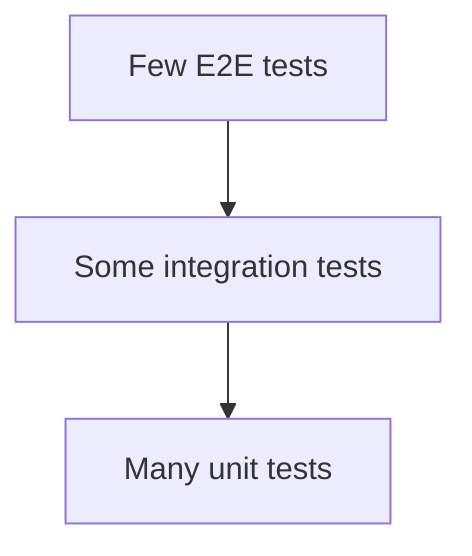

# Test Pyramid

## Problem

Suites dominated by end-to-end UI tests are slow, flaky, and expensive to debug, so developers stop running them. Suites of only unit tests miss wiring bugs between components.

## Solution

Write most tests at the unit level (pure logic, milliseconds each), a smaller set of integration tests that exercise real adapters (database, HTTP, queue, often via containers), and a thin top layer of end-to-end tests for critical user journeys. Push each check down to the lowest level that can catch the bug.



## Example

```python
# unit: pure logic, no I/O
def apply_discount(total_cents: int, pct: int) -> int:
    if not 0 <= pct <= 100:
        raise ValueError("pct out of range")
    return total_cents * (100 - pct) // 100

def test_discount():
    assert apply_discount(1000, 15) == 850

# integration: real Postgres in a throwaway container (testcontainers)
from testcontainers.postgres import PostgresContainer
import sqlalchemy as sa

def test_repository_roundtrip():
    with PostgresContainer("postgres:16") as pg:
        eng = sa.create_engine(pg.get_connection_url())
        with eng.begin() as c:
            c.execute(sa.text("CREATE TABLE t(id int primary key, v text)"))
            c.execute(sa.text("INSERT INTO t VALUES (1, 'x')"))
            assert c.execute(sa.text("SELECT v FROM t WHERE id=1")).scalar_one() == "x"

# e2e (few): critical journey through the deployed stack, e.g. Playwright
# def test_signup_and_checkout(page): page.goto(BASE_URL); ...
```

## Tradeoffs

- Fast feedback and cheap maintenance versus lower fidelity at the bottom layers.
- Some systems (thin glue over external services) justify a "testing trophy" with more integration tests.

## Failure modes

- Ice-cream cone: mostly manual and E2E tests, few unit tests.
- Unit tests that mock everything and assert on mocks, catching nothing real.
- Flaky E2E tests retried until green, hiding real failures.

## Security implications

- Include security tests at each level: unit tests for authorization rules and validators, integration tests for auth middleware, E2E for login and session flows.
- Test fixtures must not contain real credentials or production data.

## When to use

- Any codebase with CI; decide the ratio consciously.

## When not to use

- Do not follow the shape dogmatically for systems where the integration layer is where the bugs are.

Back to [[Patterns-Index]].
