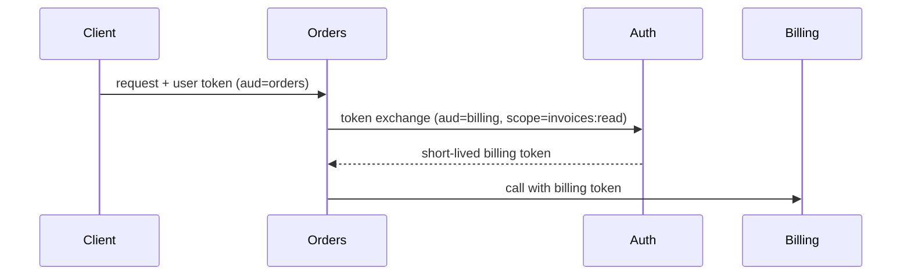

# Token Exchange

## Problem

A frontend token is forwarded unchanged through several services. Each hop can use it for anything the user can do, against any audience, until it expires. A compromised internal service, or a log that captures headers, exposes a powerful credential.

## Solution

Use OAuth 2.0 Token Exchange (RFC 8693): a service presents the incoming token (`subject_token`) to the authorization server and receives a new token with a specific `audience`, reduced `scope`, short lifetime, and optionally an `act` claim recording the calling service (delegation). Each downstream service accepts only tokens minted for its own audience.



## Example

```python
import httpx

TOKEN_URL = "https://auth.example.com/oauth2/token"

def exchange_for_downstream(user_token: str, audience: str, scope: str) -> str:
    resp = httpx.post(
        TOKEN_URL,
        data={
            "grant_type": "urn:ietf:params:oauth:grant-type:token-exchange",
            "subject_token": user_token,
            "subject_token_type": "urn:ietf:params:oauth:token-type:access_token",
            "audience": audience,              # e.g. "billing-api"
            "scope": scope,                    # e.g. "invoices:read"
        },
        auth=("orders-service", load_client_secret()),   # the calling service authenticates
        timeout=5.0,
    )
    resp.raise_for_status()
    return resp.json()["access_token"]         # short-lived, audience-bound

# Downstream (billing-api) must verify: signature, exp, iss, aud == "billing-api", scope.
```

## Tradeoffs

- Tighter blast radius per hop versus an extra round trip to the auth server (cache exchanged tokens until near expiry).
- The authorization server becomes a critical dependency and must enforce exchange policy (which service may request which audience).

## Failure modes

- Downstream services not checking `aud`, so a token for one service is replayed against another.
- Exchange policy too permissive (any service can mint any audience), recreating the original problem.
- Caching exchanged tokens past user logout or revocation.

## Security implications

- Core purpose is least privilege for delegated calls. Log the `act` chain for audit.
- Never log raw tokens; log token IDs (`jti`) instead.

## When to use

- Microservices acting on behalf of users, BFFs calling internal APIs, cross-domain federation.

## When not to use

- Single-service apps, or machine-to-machine jobs with no user context (use client credentials).

Back to [[Patterns-Index]].
