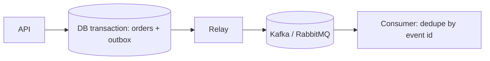

# Transactional Outbox

## Problem

A service updates its database and then publishes an event to a broker. If the process crashes between the two, the database and the event stream disagree: an order exists but no `OrderCreated` event was ever sent, or an event was sent for a rolled-back write. Distributed transactions (2PC) across DB and broker are rarely available or wanted.

## Solution

Write the event into an `outbox` table in the same local transaction as the business change. A separate relay (polling publisher or change-data-capture such as Debezium) reads unpublished outbox rows, publishes them, and marks them sent. Delivery becomes at-least-once, so consumers must be idempotent (dedupe on event id).



## Example

```python
import json, uuid

def place_order(conn, customer_id: int, total_cents: int) -> int:
    with conn:                                   # one ACID transaction
        cur = conn.execute(
            "INSERT INTO orders(customer_id, total_cents, status) VALUES (?, ?, 'placed') RETURNING id",
            (customer_id, total_cents))
        order_id = cur.fetchone()[0]
        conn.execute(
            "INSERT INTO outbox(id, aggregate_id, type, payload) VALUES (?, ?, ?, ?)",
            (str(uuid.uuid4()), order_id, "OrderPlaced",
             json.dumps({"order_id": order_id, "total_cents": total_cents})))
    return order_id

def relay_once(conn, producer, batch: int = 100) -> int:
    rows = conn.execute(
        "SELECT id, type, payload FROM outbox WHERE published_at IS NULL "
        "ORDER BY created_at LIMIT ?", (batch,)).fetchall()
    for event_id, type_, payload in rows:
        producer.send("orders", key=event_id, value=payload, headers={"type": type_})
    producer.flush()                             # wait for broker acks
    with conn:
        conn.executemany("UPDATE outbox SET published_at = CURRENT_TIMESTAMP WHERE id = ?",
                         [(r[0],) for r in rows])
    return len(rows)
```

## Tradeoffs

- Removes dual-write inconsistency at the cost of an extra table, a relay process, and some publish latency.
- At-least-once delivery pushes deduplication onto consumers.
- CDC-based relays avoid polling load but add infrastructure.

## Failure modes

- Relay crashes after publishing but before marking rows: duplicates (acceptable if consumers dedupe).
- Outbox table grows without a cleanup job.
- Multiple relay instances publishing the same rows without row locking (`FOR UPDATE SKIP LOCKED`).
- Ordering assumptions break when events for one aggregate are published in parallel.

## Security implications

- Event payloads are copies of data; do not put secrets or unnecessary PII in them, since they fan out to every consumer and log.
- Consumers must authenticate the broker and validate payloads, not trust them blindly.

## When to use

- Any service that must change its DB and notify others reliably (orders, payments, user lifecycle).

## When not to use

- Fire-and-forget notifications where an occasional lost event is acceptable, or single-service apps with no consumers.

Back to [[Patterns-Index]].
