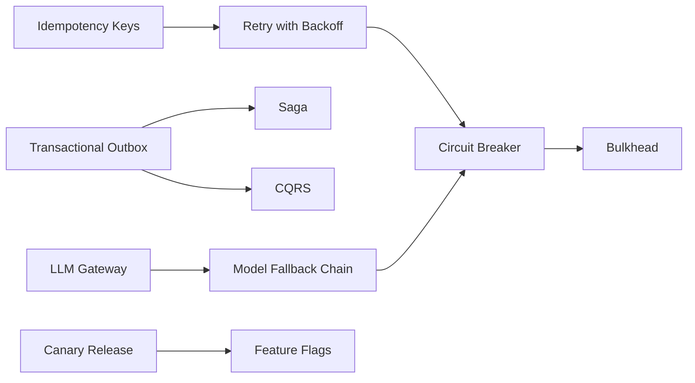

# Engineering Patterns Index

Each pattern follows the same shape: Problem, Solution, Example, Tradeoffs, Failure modes, Security implications, When to use, When not to use. Read the "When not to use" section first; most pattern misuse is applying a good pattern to the wrong problem.

## API

- [[Pattern-Pagination-Cursor]]: stable, constant-cost pagination with keyset cursors
- [[Pattern-API-Versioning]]: evolve APIs without breaking clients
- [[Pattern-Idempotency-Keys]]: make retried POSTs safe
- [[Pattern-Backend-for-Frontend]]: per-client aggregation layer

## Database

- [[Pattern-Transactional-Outbox]]: reliable event publishing with local transactions
- [[Pattern-Read-Replicas]]: scale reads, handle replication lag
- [[Pattern-Soft-Delete]]: reversible, auditable deletion
- [[Pattern-Optimistic-Locking]]: prevent lost updates without locks

## Architecture

- [[Pattern-Strangler-Fig]]: incremental legacy replacement
- [[Pattern-Hexagonal-Architecture]]: ports and adapters around a pure core
- [[Pattern-CQRS]]: separate write and read models
- [[Pattern-Saga]]: multi-service transactions with compensation

## Security

- [[Pattern-Defense-in-Depth]]: independent layered controls
- [[Pattern-Secure-Defaults]]: safe by default, unsafe by explicit opt-in
- [[Pattern-Token-Exchange]]: audience-scoped downstream tokens
- [[Pattern-Input-Validation-at-Boundaries]]: parse untrusted input once, strictly

## DevOps

- [[Pattern-Blue-Green-Deployment]]: instant cutover and rollback
- [[Pattern-Canary-Release]]: metric-gated progressive rollout
- [[Pattern-Feature-Flags]]: decouple deploy from release
- [[Pattern-Infrastructure-as-Code]]: reviewed, reproducible infrastructure

## Testing

- [[Pattern-Test-Pyramid]]: balance unit, integration, and E2E tests
- [[Pattern-Contract-Testing]]: consumer-driven API compatibility
- [[Pattern-Golden-Tests]]: reviewed expected-output files

## AI

- [[Pattern-LLM-Gateway]]: one controlled path to model providers
- [[Pattern-RAG-with-Citations]]: grounded, verifiable answers
- [[Pattern-LLM-as-Judge]]: calibrated automated evaluation
- [[Pattern-Model-Fallback-Chain]]: availability across models and providers

## Distributed systems

- [[Pattern-Circuit-Breaker]]: fail fast on failing dependencies
- [[Pattern-Retry-with-Backoff]]: jittered, bounded retries
- [[Pattern-Bulkhead]]: isolate resources per dependency or tenant
- [[Pattern-Leader-Election]]: leases plus fencing tokens

## How patterns combine

Related: [[Checklists-Index]] for step-by-step checklists, [[ADR-Index]] for recording which pattern you chose and why.
