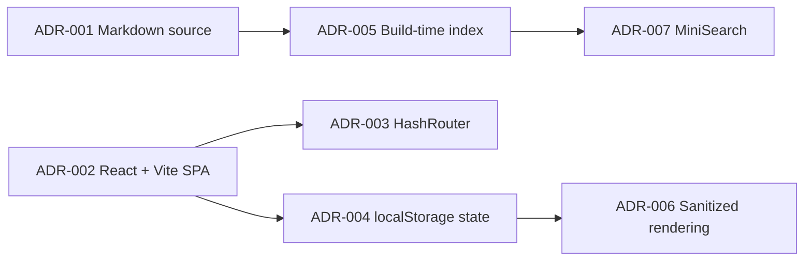

# ADR Index

An Architecture Decision Record (ADR) captures one significant decision: the context, the options, what was chosen, and what it costs. ADRs are append-only history. When a decision changes, write a new ADR and mark the old one `superseded`.

## When to write an ADR

- The decision is expensive to reverse (data store, framework, hosting, auth model).
- Reasonable engineers would disagree, and you want the reasoning on record.
- Someone will ask "why did we do it this way?" in six months.
- Skip it for reversible, local choices (a helper library, a variable name).

## How to write one

1. Copy [[ADR-Template]] to `ADR-NNN-Short-Decision-Name.md` with the next unused number.
2. Fill sections in order: Context, Problem, Options, Decision, Rationale, Tradeoffs, Consequences, Status.
3. List at least two real options, including "do nothing", each with genuine pros.
4. Write down the downsides you accept. No downsides means the analysis is incomplete.
5. Set `adr_status: proposed`, open a pull request, and change it to `accepted` on merge.
6. Never edit an accepted ADR's decision; supersede it with a new one and link both ways.

## Frontmatter

`domain: adr`, `type: adr`, `adr_status: proposed | accepted | superseded`, `date: YYYY-MM-DD`.

## Decision log (this repository)

| # | Decision | Status |
|---|---|---|
| 001 | [[ADR-001-Markdown-As-Source-of-Truth]] | accepted |
| 002 | [[ADR-002-React-Vite-Static-SPA]] | accepted |
| 003 | [[ADR-003-HashRouter-for-GitHub-Pages]] | accepted |
| 004 | [[ADR-004-LocalStorage-for-Personal-State]] | accepted |
| 005 | [[ADR-005-Build-Time-Content-Index]] | accepted |
| 006 | [[ADR-006-Sanitized-Markdown-Rendering]] | accepted |
| 007 | [[ADR-007-MiniSearch-Client-Side-Search]] | accepted |

