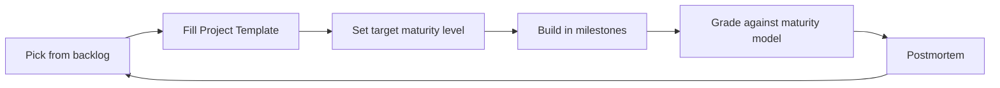

# Project Lab Index

The project lab turns ideas into finished, graded projects. The loop:

## Core

- [[Project-Maturity-Model]]: five levels with concrete exit criteria
- [[Project-Template]]: base plan for any project
- [[Project-Postmortem-Template]]: blameless retrospective
- [[Project-Ideas-Backlog]]: tracked, scoped ideas

## Domain templates

Each adds domain-specific sections and three ideas scoped by maturity level.

- [[Project-Template-AI]]
- [[Project-Template-Cybersecurity]]
- [[Project-Template-Distributed-Systems]]
- [[Project-Template-Backend]]
- [[Project-Template-Cloud]]
- [[Project-Template-DevSecOps]]
- [[Project-Template-System-Design]]
- [[Project-Template-Research]]

## Starter code

- [[FastAPI-Service-Template]]: REST service
- [[Docker-Microservice-Template]]: background worker
- [[Secure-Coding-Examples]]: defensive coding references

## Supporting notes

- [[Checklist-Starting-a-Project]], [[Checklist-Deployment]], [[Checklist-Releasing-Software]]
- [[Patterns-Index]] for design choices, [[ADR-Index]] for recording them
