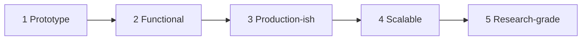

# Project Maturity Model

A project is at a level only when every exit criterion for that level and all lower levels is met. Pick a target level at the start; most portfolio projects should aim for Level 3.

| Level | Name | One-line test | Typical effort |
|---|---|---|---|
| 1 | Prototype | It works on my machine for the happy path | days |
| 2 | Functional | A stranger can run it and it handles bad input | 1-2 weeks |
| 3 | Production-ish | Deployed, tested in CI, secured, observable | 3-6 weeks |
| 4 | Scalable | Measured under load and failure, scales by design | 1-3 months |
| 5 | Research-grade | Claims are reproducible and compared to baselines | months |

## Level 1: Prototype

- [ ] Tests: at least one automated test or a scripted demo that exercises the core path.
- [ ] Docs: README states what it does and how to run it.
- [ ] CI: none required.
- [ ] Security: no secrets committed; `.env` is gitignored.
- [ ] Observability: errors are printed, not swallowed.
- [ ] Deployment: runs locally with one documented command.
- [ ] Load: not considered.

## Level 2: Functional

- [ ] Tests: unit tests cover core logic, including edge cases and invalid input.
- [ ] Docs: README has prerequisites with versions, setup, usage example, and configuration table.
- [ ] CI: lint and tests run on every push.
- [ ] Security: all input validated at the boundary; dependencies pinned via lockfile.
- [ ] Observability: structured logs with levels; clear error messages to users.
- [ ] Deployment: runs in a container or via a reproducible install on a clean machine.
- [ ] Load: known limits documented (e.g. "tested with 1k rows").

## Level 3: Production-ish

- [ ] Tests: unit plus integration tests against real dependencies (containers); critical path E2E test.
- [ ] Docs: architecture diagram, at least one ADR, API docs if it has an API.
- [ ] CI: lint, tests, build, dependency scan, and secret scan block merges; branch protection on.
- [ ] Security: threat model written; authn/authz implemented and tested; security headers; secrets from environment or a manager.
- [ ] Observability: health endpoint, request IDs in logs, basic metrics (request rate, errors, latency).
- [ ] Deployment: deployed to a public or cloud environment from CI; rollback procedure documented and tried once.
- [ ] Load: a simple load test establishes baseline p50/p95 latency and max throughput.

## Level 4: Scalable

- [ ] Tests: failure-injection tests (dependency down, slow, returns errors); contract or property tests where relevant.
- [ ] Docs: runbook for common alerts; capacity model with stated assumptions.
- [ ] CI: performance regression check or scheduled load test; infrastructure changes via IaC with plan review.
- [ ] Security: least-privilege service identities; rate limiting; dependency and image scanning with gate policy; audit logs.
- [ ] Observability: dashboards and alerts on SLO-style indicators; distributed tracing across services.
- [ ] Deployment: progressive delivery (canary or blue-green) with automated rollback; zero-downtime migrations.
- [ ] Load: horizontal scaling demonstrated with measurements; the bottleneck at the next scale step is identified.

## Level 5: Research-grade

- [ ] Tests: every result-generating script is tested or deterministic; golden outputs for key pipelines.
- [ ] Docs: written report or paper with method, results, limitations, and related work.
- [ ] CI: reproduces a reduced version of main results on each change.
- [ ] Security: data provenance and licenses documented; PII handled per ethics requirements.
- [ ] Observability: experiment tracking with configs, seeds, and environment captured for every run.
- [ ] Deployment: artifacts (code, data, weights) released with a DOI or stable tag.
- [ ] Load: compute budget and hardware stated for every reported number; comparisons to tuned baselines with variance.

## Using the model

- State the target level in the project README and in [[Project-Template]].
- Review against this page at each milestone; unchecked items become issues.
- Level 4 and 5 are not "better" for every project. Over-engineering a prototype wastes the time you should spend learning whether the idea is worth it.

Back to [[Project-Lab-Index]].
