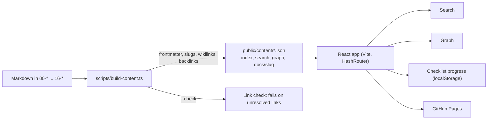

# Engineering OS

A Markdown knowledge base for CS, system design, security and AI engineering, with a static web interface for search, graph navigation and checklist tracking.

[](https://github.com/rakshit-737/engineering-os/actions/workflows/ci.yml)
[](https://github.com/rakshit-737/engineering-os/actions/workflows/deploy.yml)
[](LICENSE)

**Live site:** https://rakshit-737.github.io/engineering-os/

## What it is

- **Knowledge base.** Plain Markdown in numbered folders, readable in GitHub or Obsidian. Notes carry typed frontmatter and link to each other with `[[wikilinks]]`.
- **Web interface.** A React app built from the same files: full-text search, a link graph, backlinks, rendered Mermaid diagrams, and `- [ ]` checklist items tracked in the browser.

Markdown is the source of truth; the app is a read-only view over it.

## Content

Counts come from `public/content/index.json` (generated by `npm run content`): **501 notes, 1,474 trackable checklist items.** Each domain count includes its index notes.

| Domain | Notes | Domain | Notes |
|---|---:|---|---:|
| DSA | 84 | Research | 16 |
| Cybersecurity | 74 | Academic | 16 |
| AI engineering | 55 | Projects | 16 |
| CS core | 45 | Command center | 13 |
| System design (HLD) | 45 | Developer | 12 |
| Low-level design | 36 | Checklists | 11 |
| Career | 33 | ADRs | 9 |
| Engineering patterns | 32 | Prompts | 3 |
| | | Automation | 1 |

By type: 166 concepts, 70 patterns, 54 problems, 53 templates, 35 indexes, 30 guides, 24 checklists, 22 case studies, 13 roadmaps, 12 cheat sheets, 9 playbooks, 7 ADRs, 6 trackers.

## Repository map

| Folder | Contents | Canonical index |
|---|---|---|
| `00-Command-Center` | Dashboards, reviews, goals, journals | [Command-Center-Index](00-Command-Center/Command-Center-Index.md) |
| `01-Obsidian-Vault` | Concept notes (CS core, security, AI, interview) and vault entry point | [Home](01-Obsidian-Vault/00-Indexes/Home.md), [CS-Core-Curriculum](01-Obsidian-Vault/10-CS-Core/CS-Core-Curriculum.md), [DSA-Index](01-Obsidian-Vault/40-Interview-Prep/DSA-Index.md) |
| `02-Prompt-Library` | Reusable prompts | [README](02-Prompt-Library/README.md) |
| `03-Coding-Library` | DSA problems in Python, Java, C++ with tests | [DSA-Index](01-Obsidian-Vault/40-Interview-Prep/DSA-Index.md) |
| `04-Academic-Toolkit` | Courses, exams, study systems | [Academic-Index](04-Academic-Toolkit/Academic-Index.md) |
| `05-Research-Toolkit` | Research workflow and templates | [Research-OS-Index](05-Research-Toolkit/Research-OS-Index.md) |
| `06-Cybersecurity-Toolkit` | Foundations, offensive, defensive, appsec, cloud, playbooks, labs | [Security-Engineering-OS](06-Cybersecurity-Toolkit/Security-Engineering-OS.md) |
| `07-Developer-Toolkit` | Cheat sheets and repo templates | [Cheat-Sheet-Index](01-Obsidian-Vault/00-Indexes/Cheat-Sheet-Index.md) |
| `08-Automation-Toolkit` | Scripts and CI templates | [README](08-Automation-Toolkit/README.md) |
| `09-AI-Toolkit` | AI engineering from foundations to production | [AI-Engineering-Index](09-AI-Toolkit/AI-Engineering-Index.md) |
| `10-Career-Toolkit` | Roadmaps, resume, interviews, applications | [Career-Index](10-Career-Toolkit/Career-Index.md) |
| `11-Project-Templates` | Runnable project starters | [Project-Lab-Index](16-Project-Lab/Project-Lab-Index.md) |
| `12-System-Design` | HLD concepts, case studies, LLD | [System-Design-Index](12-System-Design/hld/System-Design-Index.md), [Case-Studies-Index](12-System-Design/case-studies/Case-Studies-Index.md), [LLD-Index](12-System-Design/lld/LLD-Index.md) |
| `13-Engineering-Patterns` | Engineering pattern library | [Patterns-Index](13-Engineering-Patterns/Patterns-Index.md) |
| `14-Checklists` | Engineering checklists | [Checklists-Index](14-Checklists/Checklists-Index.md) |
| `15-Decision-Records` | Architecture decision records | [ADR-Index](15-Decision-Records/ADR-Index.md) |
| `16-Project-Lab` | Project lab and maturity model | [Project-Lab-Index](16-Project-Lab/Project-Lab-Index.md) |

## How the web app works



The build step runs automatically before `dev` and `build`. Generated JSON is git-ignored. Details: [docs/ARCHITECTURE.md](docs/ARCHITECTURE.md).

## Quick start

Requires Node.js and npm.

```bash
npm install
npm run dev          # build content, start Vite dev server
npm run build        # build content, typecheck, production bundle
npm run lint
npm run typecheck
npm test
npm run check:links  # fail on unresolved wikilinks or broken relative links
```

## Adding content

1. Pick the folder and domain; follow [docs/CONTENT-SCHEMA.md](docs/CONTENT-SCHEMA.md) for frontmatter, file naming and section templates.
2. File names must be unique repo-wide (the slug is the file name).
3. Link the note from its domain's canonical index (table above).
4. Run `npm run check:links` before committing.

## Philosophy

- Build instead of merely consuming.
- Document instead of relying on memory.
- Automate repeated work.
- Understand systems deeply.
- Prefer fundamentals over hype.
- Learn by implementation.
- Treat security as an engineering property.
- Treat AI as an engineering tool, not a substitute for understanding.
- Every project should teach something.
- Every repeated task should become a system.

## Documentation

- [Architecture](docs/ARCHITECTURE.md)
- [Development](docs/DEVELOPMENT.md)
- [Content schema](docs/CONTENT-SCHEMA.md)
- [Architecture decision records](15-Decision-Records/ADR-Index.md)
- [Contributing](CONTRIBUTING.md), [Code of conduct](CODE_OF_CONDUCT.md)

## Security and license

Offensive security material is for authorized testing, personal labs and CTFs only. Report vulnerabilities as described in [SECURITY.md](SECURITY.md).

Licensed under the [MIT License](LICENSE).
